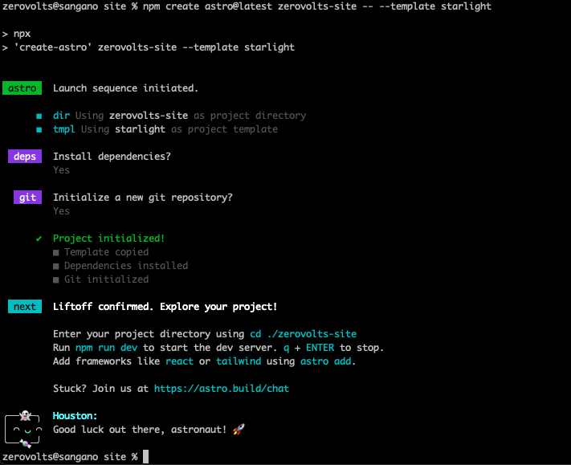
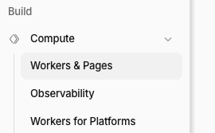
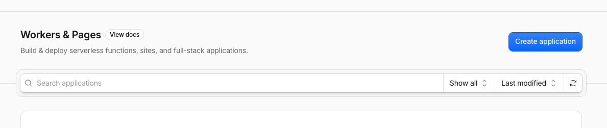
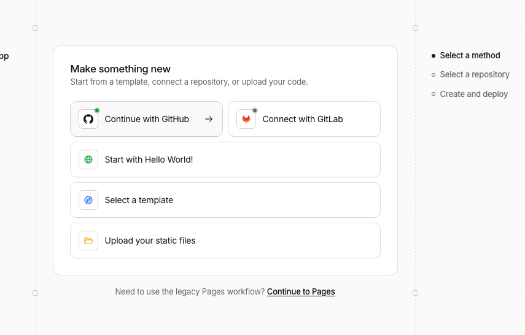
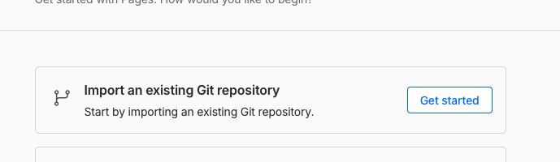
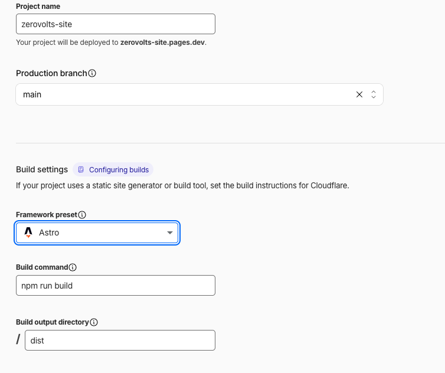

En este tutorial crearás un sitio de documentación con una portada y un primer artículo. Instalarás las herramientas, crearás el proyecto, escribirás las páginas en Markdown, guardarás el código en GitHub y conectarás Cloudflare Pages para publicar cada actualización.

Los ejemplos usan **mi_sitio** como nombre; puedes cambiarlo por el que prefieras. Primero se publicara con una dirección gratuita `pages.dev`. El dominio personalizado es un paso opcional al final.

## 1. Qué vas a utilizar

| Herramienta | Para qué sirve |
| --- | --- |
| Astro | Construye las páginas del sitio a partir de tus archivos |
| Starlight | Añade un diseño de documentación, navegación y búsqueda a Astro |
| Markdown | Permite escribir artículos con títulos, enlaces, imágenes y código |
| Node.js y npm | Ejecutan las herramientas e instalan dependencias en tu equipo |
| Git | Guarda el historial de cambios del proyecto |
| GitHub | Aloja una copia del código y su historial |
| Cloudflare Pages | Compila el código de GitHub y publica el sitio |

Usaremos Astro con la plantilla Starlight porque el objetivo es publicar tutoriales. Astro también permite crear otros tipos de páginas con otras plantillas. Aquí generaremos un sitio **estático**: el build produce HTML, CSS y JavaScript que Cloudflare puede servir. No hace falta una base de datos ni configurar un adaptador para ejecutar Astro en un servidor.

El flujo que aprenderás será:

```text
Crear o editar una página Markdown
               ↓
Revisar en el navegador local
               ↓
npm run build: comprobar y generar el sitio
               ↓
git commit y git push: enviar el código a GitHub
               ↓
Cloudflare Pages compila y publica la actualización
```

`npm run build` no sube archivos a GitHub ni publica por sí solo. En este paso a paso, la publicación la realiza Pages al recibir un cambio del repositorio conectado.

## 2. Preparar las herramientas

Necesitas una terminal, un editor de texto —por ejemplo Visual Studio Code— y acceso a Internet. Los comandos siguientes están escritos para macOS y Linux. En Windows puedes usar WSL para seguirlos con una terminal Linux.

### Instalar Node.js y npm

La versión instalada de Astro en este sitio requiere Node 22.23.4 o superior. Usa Node 24 para este paso a paso y comprueba los requisitos de la versión que instales; el generador puede actualizarse.

Una forma de administrar Node es **nvm**, que permite instalar y seleccionar distintas versiones:

1. Instala nvm siguiendo sus [instrucciones oficiales](https://github.com/nvm-sh/nvm#installing-and-updating).
2. Abre una terminal nueva.
3. Instala y selecciona Node:

```bash
nvm install 24
nvm use 24
node --version
npm --version
```

Debes ver una versión de Node compatible y una versión de npm. npm viene incluido con Node. Si ya instalaste una versión compatible desde [nodejs.org](https://nodejs.org/en/download), puedes usarla sin instalar nvm; en ese caso omite los comandos `nvm` del tutorial.

### Instalar Git

Instala Git siguiendo las [instrucciones para tu sistema operativo](https://git-scm.com/downloads) y comprueba:

```bash
git --version
```

### Crear las cuentas

Crea una cuenta en [GitHub](https://github.com/signup) y otra en [Cloudflare](https://dash.cloudflare.com/sign-up). No necesitas comprar un dominio para empezar.

Para autenticar los envíos de código por HTTPS, instala también [GitHub CLI](https://cli.github.com/) y ejecuta:

```bash
gh --version
gh auth login
gh auth setup-git
gh auth status
```

Durante el inicio de sesión elige GitHub.com, HTTPS e identificación mediante el navegador. Si ya usas Git con SSH, puedes mantener ese método y usar la URL SSH del repositorio más adelante.

**Antes de continuar:** Node, npm y Git deben responder con sus versiones. No necesitas instalar Astro globalmente: se instalará dentro del proyecto.

## 3. Crear el proyecto con Starlight

Elige una carpeta para guardar tus proyectos. Este ejemplo crea `proyectos` en tu directorio personal y un proyecto nuevo llamado `mi_sitio`:

```bash
mkdir -p ~/proyectos
cd ~/proyectos
npm create astro@latest mi_sitio -- --template starlight
cd mi_sitio
```



El generador descarga la plantilla y crea los archivos iniciales. Acepta instalar las dependencias. Puedes responder que no a inicializar Git: lo haremos mas adelante. Si ya lo inicializó, no hay problema.


Si omitiste la instalación de dependencias, ejecútala ahora, desde `mi_sitio/`:

```bash
npm install
```

Este comando lee `package.json`, descarga Astro y las demás librerías a `node_modules/` y genera o actualiza `package-lock.json`. Si aparece `sh: astro: command not found` al iniciar el sitio, comprueba que estás en esta carpeta y que la instalación terminó correctamente.

Si usas nvm, crea un archivo llamado `.nvmrc`, junto a `package.json`, con este contenido:

```text
24
```

En futuras terminales podrás seleccionar la versión del proyecto con `nvm use` desde esa carpeta. Si aún no está instalada, ejecuta antes `nvm install`.

**Resultado esperado:** dentro de `mi_sitio/` debes ver `package.json`, `astro.config.mjs` y la carpeta `src/`. La creación del starter se explica también en la [guía de Starlight](https://starlight.astro.build/getting-started/).

## 4. Entender los directorios antes de modificarlos

Llamaremos **raíz del proyecto** a `mi_sitio/`, la carpeta que contiene `package.json`. A partir de ahora ejecuta los comandos desde esa raíz. Puedes comprobar dónde estás con `pwd` y qué contiene la carpeta con `ls`.

| Ruta desde la raíz | Función |
| --- | --- |
| `package.json` | Dependencias y comandos como `dev`, `build` y `preview` |
| `package-lock.json` | Versiones concretas de las dependencias; se guarda en Git |
| `astro.config.mjs` | Configuración de Astro y Starlight: título, idioma y menú |
| `src/content.config.ts` | Define la colección de documentación que utiliza Starlight |
| `src/content/docs/` | Contiene las páginas Markdown y MDX del sitio |
| `src/content/docs/index.mdx` | Página principal, que se abre en `/` |
| `src/assets/` | Imágenes que Astro puede procesar |
| `public/` | Archivos que se copian al sitio sin transformar |
| `node_modules/` | Dependencias descargadas; no se sube a Git |
| `.astro/` | Archivos generados por Astro; no se edita ni se sube a Git |
| `dist/` | Resultado del build; no se edita ni se sube a Git en este flujo |

Conserva `src/content.config.ts` tal como lo genera el starter. No necesitas modificarlo para escribir artículos.

### Directorio del contenido

Vamos a crear una carpeta `meta/` dentro de `src/content/docs/`. Elegimos ese nombre para agrupar documentación sobre el propio sitio. **Es una decisión de organización, no un nombre obligatorio de Astro.**

Podrías usar `tutoriales/`, `guias/` o guardar tus artículos directamente en `docs/`. Elegir un subdirectorio afecta a dos cosas:

1. Forma parte de la dirección de sus artículos: `meta/archivo.md` se publicará por defecto en `/meta/archivo/`.
2. Puedes indicarle al menú que muestre los artículos de esa carpeta.

El directorio se crea con `mkdir` en el siguiente paso. La propiedad `sidebar` de `astro.config.mjs` decidirá cómo aparece en el menú. La configuración del menú no crea el directorio ni escribe las páginas. [Páginas de Starlight](https://starlight.astro.build/guides/pages/).

## 5. Limpiar los ejemplos y configurar el sitio

El starter trae páginas de ejemplos. En el editor, abre `src/content/docs/`, elimina las carpetas `guides/` y `reference/` si están presentes y los demás artículos de ejemplo. Conserva `index.mdx`, que reemplazaremos en el paso 7.

Ahora crea el directorio para el primer documento/articulo o tutorial:

```bash
mkdir -p src/content/docs/meta
```

Reemplaza el contenido de `astro.config.mjs` por lo siguiente:

```js
import { defineConfig } from 'astro/config';
import starlight from '@astrojs/starlight';

export default defineConfig({
  output: 'static',
  integrations: [
    starlight({
      title: 'Mi sitio',
      locales: {
        root: { label: 'Español', lang: 'es' },
      },
      sidebar: [
        { label: 'Inicio', link: '/' },
        {
          label: 'Tutoriales',
          items: [{ autogenerate: { directory: 'meta' } }],
        },
      ],
    }),
  ],
});
```

### Qué significa esta configuración

- `output: 'static'` genera los archivos durante la compilación.
- `starlight(...)` activa el tema de documentación.
- `title` es el nombre global del sitio, independiente del nombre de la carpeta y de los archivos de los artículos.
- `locales.root` con `lang: 'es'` configura el español sin prefijo `/es/` en las direcciones.
- `sidebar` define el menú lateral. `Inicio` abre `/`.
- `label: 'Tutoriales'` es el texto del grupo del menú; no tiene que llamarse igual que la carpeta.
- `autogenerate.directory: 'meta'` lee artículos dentro de `src/content/docs/meta/`. Esa ruta es relativa a `docs/`.

Si eliges otra carpeta, cambia tanto el `mkdir` como `directory` y los enlaces que la mencionen. No agregues grupos para carpetas vacías que todavía no tengan artículos.

En este punto no definimos una dirección `site`, porque todavía no sabemos cuál será la URL publicada. La agregaremos cuando Pages la entregue. Para todas las opciones consulta la [referencia de configuración](https://starlight.astro.build/reference/configuration/).

### Los estilos personalizados son opcionales

La configuración anterior ya funciona con el diseño predeterminado de Starlight. No necesitas crear CSS para tener menú, modo claro y oscuro o diseño adaptable.

Si después quieres cambiar los colores, podrás crear `src/styles/custom.css` y agregar `customCss: ['./src/styles/custom.css']` dentro de `starlight({ ... })`. Los estilos globales se configuran una vez para el sitio, no por cada artículo. [Personalización de estilos](https://starlight.astro.build/guides/css-and-tailwind/).

## 6. Escribir el primer artículo directamente

En tu editor crea este archivo, dentro de la carpeta `meta/`:

```text
src/content/docs/meta/01-construyendo-el-sitio.md
```

Escribe este contenido inicial:

````markdown
---
title: Crear mi sitio con Astro
description: Primeros pasos para construir y publicar un sitio de documentación.
sidebar:
  order: 1
---

Este artículo documenta la creación de mi sitio con Astro y Starlight.

## Objetivo

Crear una portada, escribir un tutorial y publicar el sitio con Cloudflare Pages.

## Crear el proyecto

```bash
npm create astro@latest mi_sitio -- --template starlight
```

## Resultado

El sitio tendrá una portada y este primer artículo.
````

Este archivo es el artículo que Astro publicará. **Escribe y actualiza aquí su contenido.** Puedes ampliarlo mientras vamos armando el sitio con el paso a paso, capturas, comandos y explicaciones. 

El bloque inicial entre `---` se llama **frontmatter**:

| Campo | Significado |
| --- | --- |
| `title` | Título visible de este artículo; es obligatorio |
| `description` | Descripción para metadatos; recomendable |
| `sidebar.order` | Posición dentro del menú autogenerado; opcional |

Después del frontmatter comienza el contenido. Usa encabezados `##` para sus secciones: Starlight ya muestra `title` como encabezado principal. La tabla de contenidos del artículo se genera con esos encabezados, mientras que el menú lateral se define en la configuración del sitio.

### Nombre de documentos/articulos etc

En este ejemplo se uso como nombre del articulo **01-construyendo-el-sitio.md**, 
Puedes nombrar el archivo `making-site.md`, `crear-sitio.md` o cualquier otro nombre descriptivo. Es preferible usar minúsculas y guiones, sin espacios. Un prefijo numérico puede ayudar a ordenar los archivos, pero no es obligatorio.

| Archivo dentro de `src/content/docs/` | Dirección por defecto |
| --- | --- |
| `meta/01-construyendo-el-sitio.md` | `/meta/01-construyendo-el-sitio/` |
| `meta/making-site.md` | `/meta/making-site/` |
| `making-site.md` | `/making-site/` |
| `index.mdx` | `/` |

El título visible viene de `title`, no del nombre del archivo. `sidebar.order: 1` permite controlar el orden sin numerar los nombres; sin un orden explícito, el menú autogenerado ordena alfabéticamente por el identificador de archivo. [Navegación de Starlight](https://starlight.astro.build/guides/sidebar/).

Si cambias el nombre a `making-site.md`, actualiza los enlaces escritos a mano para usar `/meta/making-site/`. El menú autogenerado detecta el nuevo archivo, pero los botones de la portada no cambian solos. También existe un campo `slug` para personalizar la dirección independientemente del archivo.

## 7. Crear la página principal

`src/content/docs/index.mdx` es la pagina principal o "dashboard": la página que se abre al visitar la raíz del sitio, por ejemplo `http://localhost:4321/`. No es un índice automático de artículos ni configura el menú lateral.

La extensión `.mdx` permite usar Markdown y componentes. El siguiente ejemplo solo necesita Markdown y frontmatter. Reemplaza el contenido de `index.mdx` por:

```mdx
---
title: Mi sitio
description: Documentación y tutoriales paso a paso.
template: splash
hero:
  tagline: Aprende a crear y publicar tu primer sitio con Astro.
  actions:
    - text: Leer el primer tutorial
      link: /meta/01-construyendo-el-sitio/
      icon: right-arrow
---

## Primer tutorial

Comienza creando un sitio de documentación con Astro y Starlight,
guarda su código en GitHub y publícalo en Cloudflare Pages.

[Crear el sitio paso a paso](/meta/01-construyendo-el-sitio/)
```

- `template: splash` usa un diseño de portada, sin el menú lateral habitual de un artículo. Si lo quitas, se usa el diseño normal de documentación.
- `hero.tagline` es la presentación destacada.
- `hero.actions` contiene los botones. `text` es la etiqueta y `link` es su destino.
- El texto después del segundo `---` aparece debajo de la presentación.

Si elegiste otro nombre para el artículo, modifica los dos enlaces de este ejemplo. [Campos de portada y artículos](https://starlight.astro.build/reference/frontmatter/).

Ahora la colección debe tener solamente estas páginas:

```text
src/content/docs/
├── index.mdx
└── meta/
    └── 01-construyendo-el-sitio.md
```

Quitar un enlace del menú no elimina una página. Para no publicar las demostraciones del starter, sus archivos deben quedar fuera de `src/content/docs/`.

## 8. Probar el sitio localmente

Desde la raíz del proyecto, selecciona Node si usas nvm y arranca el servidor:

```bash
nvm use
npm run dev -- --background
```

Abre la dirección que indique la terminal, normalmente `http://localhost:4321`. El puerto puede cambiar si ya está ocupado.

Comprueba la portada, pulsa el botón y abre el primer artículo. Cambia una frase del archivo `.md`, guarda y revisa la actualización en el navegador. El servidor de desarrollo permite trabajar sin generar un build en cada edición.

En la versión de Astro 7 usada para comprobar este tutorial, el servidor en segundo plano se administra con:

```bash
npm run astro -- dev status
npm run astro -- dev logs
npm run astro -- dev stop
```

Si la versión que instalaste no reconoce `--background`, puedes ejecutar `npm run dev` en una terminal y dejarla abierta mientras trabajas. En ese modo se detiene con `Ctrl+C`.

## 9. Generar y revisar la versión publicable

Ejecuta:

```bash
npm run build
```

Astro convierte el contenido y la configuración en archivos dentro de `dist/`. No edites esa carpeta: el siguiente build vuelve a generarla. Si falla, corrige el primer error del registro antes de continuar.

Antes de definir la URL pública puede aparecer el aviso `The Sitemap integration requires the site astro.config option. Skipping.`. El build del sitio puede terminar correctamente; solo se omite el sitemap hasta que agregues `site` en el paso 12.

Para revisar ese resultado en el navegador:

```bash
npm run preview
```

Abre la dirección que muestre la terminal y comprueba:

- La portada abre el tutorial correcto.
- Las secciones y bloques de código se leen correctamente.
- La búsqueda encuentra una frase del artículo. Pagefind genera su índice durante el build; pruébalo aquí.
- La ruta del artículo funciona al abrirla directamente y al recargar.

Detén `preview` con `Ctrl+C` cuando termines. Todavía no has publicado en Internet: tanto `dev` como `preview` sirven el sitio desde tu equipo.

### Qué ocurre entre edición y publicación

El servidor de desarrollo transforma los archivos al solicitarlos y facilita revisar cambios mientras editas. `npm run build` procesa la colección de contenido y genera archivos estáticos en `dist/`; `npm run preview` sirve esa salida ya generada para inspeccionarla. Si el servidor de desarrollo muestra un cambio pero la versión previa no, vuelve a ejecutar el build: preview no convierte automáticamente las nuevas ediciones. Ninguno de esos pasos envía el sitio a Internet.

Git guarda versiones del código fuente, no de los archivos generados que estén ignorados. Un *commit* registra una instantánea local de los cambios preparados; `push` transmite commits a un remoto. El proveedor de alojamiento puede observar esa rama y construir otra copia. Así se puede comprobar qué versión local se envió y qué versión desplegó el servicio.

## 10. Guardar el proyecto en GitHub

### Inicializar Git y preparar el primer commit

Desde la raíz comprueba si ya hay un repositorio:

```bash
git rev-parse --show-toplevel
```

Si indica que no es un repositorio, ejecuta:

```bash
git init
```

Si ya muestra la carpeta de tu proyecto, continúa. Si muestra una carpeta superior que contiene otros trabajos, revisa la ubicación antes de añadir archivos.

Comprueba que `.gitignore` excluya al menos:

```text
node_modules/
dist/
.astro/
.env
.env.*
!.env.example
.DS_Store
```

`package.json`, `package-lock.json`, `.nvmrc`, la configuración y los artículos sí se guardan en Git. Si usas `.env.example`, solo debe contener valores de ejemplo. Este sitio estático no necesita tokens de Cloudflare dentro del código.

Configura la identidad del autor con tus datos:

```bash
git config user.name "Tu nombre"
git config user.email "TU_CORREO_DE_GITHUB"
```

Puedes usar el correo privado `noreply` que aparece en las preferencias de GitHub. Luego prepara y revisa los archivos:

```bash
git status --short
git add .
git diff --cached --stat
```

Si la lista corresponde al proyecto y no incluye carpetas generadas ni secretos, crea el primer commit:

```bash
git commit -m "Crear el sitio con Astro y Starlight"
git branch -M main
```

Un commit guarda una versión local. Aún falta enviarla a GitHub.

### Qué hacen los comandos de Git

`git status --short` resume archivos nuevos y modificados; `git add .` prepara los cambios para el siguiente commit y respeta las reglas de `.gitignore`. `git diff --cached --stat` muestra un resumen de lo preparado, no el contenido completo: para inspeccionar las líneas usa `git diff --cached`. `git commit -m` crea el commit local con el mensaje indicado y `git branch -M main` renombra la rama actual a `main`; el último comando puede sobrescribir una rama local existente con ese nombre, así que revisa las ramas primero con `git branch`.

La identidad de `git config user.name` y `user.email` se escribe en los commits; no autentica contra GitHub. `gh auth login` configura la autenticación y `gh auth setup-git` integra Git con ella. No confundas esa identidad con los permisos de acceso al repositorio remoto.

### Crear y conectar el repositorio remoto

En [github.com/new](https://github.com/new), crea un repositorio llamado `mi-sitio`(o el nombre de tu sitio). Puede ser público si quieres que los lectores consulten el código. Déjalo vacío: no agregues README, licencia ni `.gitignore` desde GitHub porque ya tienes un proyecto local.

Copia su URL y sustituye `TU_USUARIO` en estos comandos por tu usuario u organización real:

```bash
git remote add origin https://github.com/TU_USUARIO/mi-sitio.git
git remote -v
git push -u origin main
```

Si `origin` ya existe, revisa su dirección con `git remote -v`. No lo agregues otra vez si es correcto; para corregirlo utiliza `git remote set-url origin URL_REAL`.

**Resultado esperado:** al abrir el repositorio en GitHub ves `src/`, la configuración y el commit de `main`. No debes ver `node_modules/` ni `dist/`.

## 11. Publicar con Cloudflare Pages

Usaremos **Pages con integración Git** para que Cloudflare compile el código del repositorio. En el panel puede aparecer Workers como opción principal; busca la opción específica de Pages para seguir este recorrido. [Plataformas y guías de Cloudflare](https://developers.cloudflare.com/pages/framework-guides/).

En [Cloudflare Dashboard](https://dash.cloudflare.com/):

1. Entra en **Workers & Pages → Create application**. 


2. Selecciona **Pages** y después **Connect to Git** o **Import an existing Git repository**; el texto puede variar entre pantallas.

3. Conecta GitHub y autoriza el acceso al repositorio `mi-sitio`.
4. Selecciona el repositorio y comienza la configuración.

5. Completa los valores siguientes:

| Campo | Valor |
| --- | --- |
| Project name | Un nombre disponible, por ejemplo `mi-sitio` |
| Production branch | `main` |
| Framework preset | `Astro`, si aparece |
| Build command | `npm run build` |
| Build output directory | `dist` |
| Root directory | Vacío si `package.json` está en la raíz del repositorio |



La carpeta local puede llamarse `mi_sitio` y el repositorio `mi-sitio`; eso no cambia la raíz del repositorio. No escribas el nombre de la carpeta local en Root directory si `package.json` ya aparece en la raíz de GitHub.

Pages puede leer `.nvmrc`. Si también defines la variable `NODE_VERSION` en el panel, usa `24` para **Production y Preview**, coherente con ese archivo y con los requisitos del proyecto. [Versiones del entorno de build](https://developers.cloudflare.com/pages/configuration/build-image/).

Selecciona **Save and Deploy**. Revisa el log: debe instalar dependencias, ejecutar el build y publicar `dist/`. Si te pide un comando `wrangler deploy`, comprueba que hayas elegido Pages y no el flujo de Workers.

Al finalizar, Pages entregará una URL como `https://mi-sitio.pages.dev`, según el nombre que hayas conseguido. Abre la dirección **real** y prueba también la ruta del artículo. [Integración Git de Pages](https://developers.cloudflare.com/pages/get-started/git-integration/) y [configuración de Astro](https://developers.cloudflare.com/pages/framework-guides/deploy-an-astro-site/).

## 12. Enlazar el sitio con su código y su URL pública

### Configurar la URL de producción

Una vez conocida la URL de Pages, agrega `site` al nivel principal de `astro.config.mjs`, junto a `output` e `integrations`. Usa la dirección real del proyecto:

```js
site: 'https://TU_PROYECTO_REAL.pages.dev',
```

`site` sirve para generar enlaces canónicos y sitemap con la dirección pública. No registra dominios ni modifica DNS. Más adelante podrás cambiarlo al dominio propio.

### Mostrar el enlace al repositorio

Dentro de `starlight({ ... })`, junto a `title`, `locales` y `sidebar`, agrega estas propiedades. Sustituye `TU_USUARIO` por la cuenta real y verifica el nombre del repositorio:

```js
social: [
  {
    icon: 'github',
    label: 'Código del sitio',
    href: 'https://github.com/TU_USUARIO/mi-sitio',
  },
],
editLink: {
  baseUrl: 'https://github.com/TU_USUARIO/mi-sitio/edit/main/',
},
```

El icono de GitHub abre el repositorio. «Editar esta página» abre el archivo del artículo: Starlight agrega `src/content/docs/...` a `baseUrl`, por lo que no debes añadir esa ruta otra vez. No dupliques `social` si ya lo configuraste; modifica su valor. [Configuración de enlaces de edición](https://starlight.astro.build/reference/configuration/#editlink).

Puedes agregar también un enlace Markdown al repositorio dentro del artículo. Si es privado, los lectores sin permiso no podrán abrirlo aunque conozcan la URL.

Comprueba y publica los cambios:

```bash
npm run build
git add astro.config.mjs src/content/docs
git commit -m "Enlazar la URL pública y el código del sitio"
git push
```

Pages iniciará otro deployment. Verifica que corresponda al último commit y prueba los enlaces de GitHub en la versión publicada.

## 13. Actualizar el artículo existente

Edita directamente `src/content/docs/meta/01-construyendo-el-sitio.md`. Revisa el cambio en `dev` y ejecuta:

```bash
npm run build
git add src/content/docs/meta/01-construyendo-el-sitio.md
git commit -m "Actualizar el primer tutorial"
git push
```

No necesitas recrear el proyecto, instalar dependencias otra vez ni copiar el artículo a otra ubicación. El build comprueba el sitio; commit guarda el cambio; push lo envía; Pages compila y publica.

**Comprobación:** cambia una frase identificable y búscala en la URL pública después de que termine el deployment. Así verificas todo el circuito.

## 14. Cómo agregar nuevos tutoriales después

Cuando tengas otro artículo listo, crea un nuevo `.md` en la carpeta existente, por ejemplo `src/content/docs/meta/conectar-dominio.md`:

```markdown
---
title: Conectar un dominio propio
description: Cómo asociar un dominio con un sitio publicado en Cloudflare Pages.
sidebar:
  order: 2
---

## Objetivo

Explica el resultado que podrá reproducir el lector.

## Requisitos

Indica qué cuentas, archivos o herramientas necesita.

## Procedimiento

Escribe los pasos con sus comandos y resultados esperados.
```

Completa ese contenido antes de publicarlo. Como el menú ya autogenera la carpeta `meta/`, el artículo aparecerá allí sin modificar la configuración. Su dirección será `/meta/conectar-dominio/`.

Para otra categoría, crea su carpeta y el primer artículo antes de añadir un nuevo grupo al menú con `autogenerate.directory` apuntando a ella. No hace falta una carpeta por artículo.

El proceso de publicación se repite:

```bash
npm run build
git add src/content/docs/meta/conectar-dominio.md
git commit -m "Agregar tutorial sobre dominios"
git push
```

Si cambias además la configuración o agregas imágenes, incluye también esos archivos en el commit. Para archivos de `public/imagenes/`, usa enlaces como `/imagenes/diagrama.svg`; no incluyas `public` en la URL. Para imágenes procesadas en `src/assets/`, usa rutas relativas desde el artículo. [Contenido e imágenes en Starlight](https://starlight.astro.build/guides/authoring-content/).

## 15. Conectar un dominio propio (opcional)

Primero deja funcionando la dirección `pages.dev`. Puedes seguir utilizándola sin comprar un dominio.

### Dominio raíz, por ejemplo `tudominio.com`

1. Compra o utiliza un dominio que controles.
2. Agrégalo como zona en la misma cuenta de Cloudflare del proyecto Pages.
3. Revisa los registros DNS existentes, incluidos los de correo si los hay.
4. En el registrador configura los nameservers que Cloudflare te asigne y espera a que la zona esté activa.
5. En el proyecto Pages entra en **Custom domains → Set up a domain** y agrega el dominio.
6. Sigue el asistente y espera a que el dominio y su certificado HTTPS estén activos.

### Subdominio con DNS externo, por ejemplo `docs.tudominio.com`

1. Agrega primero el subdominio en **Custom domains** del proyecto Pages.
2. En el proveedor DNS crea un `CNAME` para `docs` con destino al hostname real `TU_PROYECTO.pages.dev`, sin `https://` ni rutas.
3. Espera la activación y comprueba HTTPS.

Para el dominio raíz de Pages, la zona y sus nameservers deben estar en Cloudflare. Un subdominio puede usar DNS externo. Crear solo el CNAME sin asociarlo primero al proyecto puede producir un error 522. [Dominios personalizados de Pages](https://developers.cloudflare.com/pages/configuration/custom-domains/).

Cuando funcione el dominio, cambia `site` a su dirección HTTPS, ejecuta el build, haz commit y push. Comprueba la portada y una ruta interna. Si quieres redirigir la dirección `pages.dev` al dominio, sigue la [guía de redirección de Cloudflare](https://developers.cloudflare.com/pages/how-to/redirect-to-custom-domain/).

## 16. Errores frecuentes

| Problema | Qué revisar |
| --- | --- |
| `astro: command not found` | Estar junto a `package.json` y completar `npm install` |
| El generador no encuentra la plantilla | Usar `--template starlight` |
| Astro rechaza la versión de Node | Seleccionar una versión compatible en esa misma terminal |
| `--background` no está disponible | Ejecutar `npm run dev` y dejar abierta esa terminal |
| El menú apunta a una carpeta inexistente | Revisar `autogenerate.directory` y crear el artículo correspondiente |
| El botón abre una página que no existe | Comparar su `link` con el nombre y la ubicación real del `.md` |
| El archivo no lleva número y aparece desordenado | Configurar `sidebar.order`; el prefijo numérico no es obligatorio |
| Falta un CSS durante el build | Quitar `customCss` si no creaste el archivo referenciado |
| El buscador no encuentra contenido nuevo | Ejecutar build y comprobarlo en preview o en el deployment nuevo |
| GitHub rechaza el envío | Comprobar autenticación con `gh auth status`, URL y permisos |
| Pages no encuentra `package.json` | Revisar Root directory del repositorio |
| Pages usa otro Node | Revisar `.nvmrc` y `NODE_VERSION` en Production y Preview |
| El sitio publicado conserva una versión anterior | Revisar rama, commit y estado del último deployment |
| El enlace de edición da 404 | Revisar usuario, repositorio, rama y `baseUrl` terminado en `/edit/main/` |
| El dominio no activa o devuelve 522 | Revisar Custom domains, DNS y estado del certificado |

## 17. Qué queda listo al terminar

- Una portada y un artículo escritos directamente en `src/content/docs/`.
- Un proyecto que funciona localmente y compila en `dist/`.
- El código y su historial en GitHub.
- Pages conectado al repositorio para publicar los cambios.
- Enlaces desde el sitio a su código y al archivo de cada página.
- Un flujo repetible para actualizar el artículo y agregar los siguientes.

La configuración inicial se hace una vez. En el trabajo habitual escribirás Markdown, comprobarás el build y enviarás los cambios. Conserva `package-lock.json`, revisa las actualizaciones de dependencias y consulta los [límites vigentes de Pages](https://developers.cloudflare.com/pages/platform/limits/) si el proyecto crece.


Y con esto ya habras montado un sitio basico estatico para mostrar articulos, documentos, tutoriales o un blog si asi lo quieres, como por ejemplo este que acabas de leer.