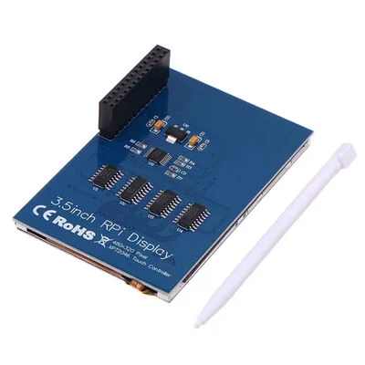

En este tutorial vamos a conectar y configurar una **pantalla TFT SPI de 3,5 pulgadas con controlador touch XPT2046** en una **Raspberry Pi 4**. Al terminar, sabrás cómo habilitar la pantalla en Linux, comprobar que el sistema detecta su entrada touch y analizar las coordenadas de las pulsaciones.



**Esta es la pantalla utilizada en las pruebas.** Si tienes una igual o compatible, puedes seguir la misma configuración. En otras pantallas SPI pueden cambiar el controlador de imagen y el *overlay* necesario.

## 1. Materiales y conexión

Necesitarás:

- Raspberry Pi 4 con una distribución Linux compatible y acceso a terminal.
- Pantalla TFT SPI de 3,5 pulgadas con XPT2046, como la de la fotografía.
- Fuente de alimentación apropiada para la Raspberry Pi.

La pantalla de la fotografía se instala directamente sobre el **conector GPIO de 40 pines** de la Raspberry Pi. Apaga y desconecta la alimentación, alinea el conector de la pantalla con los pines de la Raspberry Pi y presiónalo suavemente hasta que quede bien conectado.

### ¿Qué señales utiliza?

La pantalla y el controlador táctil pueden compartir el bus **SPI** (*Serial Peripheral Interface*). Estas son las señales de SPI0 de la Raspberry Pi 4:

| Señal | GPIO BCM | Pin físico | Función |
| --- | ---: | ---: | --- |
| MOSI | 10 | 19 | Datos enviados por la Raspberry Pi |
| MISO | 9 | 21 | Datos recibidos desde un periférico |
| SCLK | 11 | 23 | Reloj de la comunicación |
| CE0 | 8 | 24 | Selección de un dispositivo SPI |
| CE1 | 7 | 26 | Selección de otro dispositivo SPI |
| GND | — | 20, entre otros | Referencia eléctrica común |

## 2. Habilitar SPI y configurar la pantalla

Linux necesita saber qué pantalla está conectada y qué controlador debe cargar. Para nuestro montaje, la configuración probada es:

```ini
dtparam=spi=on
dtoverlay=piscreen,drm,speed=18000000,rotate=90
```

### Editar el archivo de arranque

En Raspberry Pi OS reciente, abre una terminal y crea una copia de seguridad:

```bash
sudo cp /boot/firmware/config.txt /boot/firmware/config.txt.bak
```

- `sudo`: ejecuta el comando con permisos de administrador.
- `cp`: copia un archivo; aquí conserva la configuración original como `config.txt.bak`.

Abre el archivo:

```bash
sudo nano /boot/firmware/config.txt
```

Busca si ya existe una línea `dtparam=spi=on` o `dtoverlay=piscreen` para no duplicarla. Agrega o ajusta estas líneas:

```ini
dtparam=spi=on
dtoverlay=piscreen,drm,speed=18000000,rotate=90
```

En `nano`, guarda con `Ctrl+O`, confirma con Enter y sal con `Ctrl+X`.

> **Nota de ruta:** algunas distribuciones utilizan `/boot/config.txt` en vez de `/boot/firmware/config.txt`. Puedes comprobar cuál existe con `ls /boot/firmware/config.txt /boot/config.txt` y editar el correspondiente.

### ¿Qué hace esta configuración?

| Parámetro | Qué hace |
| --- | --- |
| `dtparam=spi=on` | Habilita la interfaz SPI de la Raspberry Pi. |
| `dtoverlay=piscreen` | Carga la descripción de hardware y la configuración del controlador para una pantalla compatible con PiScreen. |
| `drm` | Activa la modalidad DRM del overlay utilizado, si está disponible en el sistema. |
| `speed=18000000` | Solicita una velocidad SPI de **18 MHz** (18 millones de ciclos de reloj por segundo). |
| `rotate=90` | Establece una rotación de **90 grados** para la imagen mediante el overlay. |

Un *overlay* es una configuración de **Device Tree**: informa al kernel qué dispositivos existen, cómo están conectados y qué controladores debe asociarles. No es un programa de escritorio; se aplica durante el arranque.

Si quieres consultar los parámetros que admite tu instalación, utiliza:

```bash
dtoverlay -h piscreen
```

Finalmente reinicia:

```bash
sudo reboot
```

**Resultado esperado:** en la pantalla compatible con la fotografía debería activarse la imagen tras el arranque, con la orientación configurada. Si la pantalla se ilumina pero no muestra contenido, puedes revisar al final del tutorial y ver los problemas frecuentes.

## 3. Comprobar que Linux reconoce la pantalla

Que se encienda la retroiluminación no significa necesariamente que esté funcionando el controlador gráfico. Vamos a comprobar qué ha registrado Linux.

### Buscar dispositivos de imagen

Ejecuta:

```bash
ls -l /dev/fb*
```

`ls` enumera archivos; `-l` muestra información detallada y `*` busca nombres coincidentes. En sistemas que exponen un *framebuffer*, puedes obtener algo parecido a:

```text
crw-rw---- 1 root video 29, 0 Oct 26 17:17 /dev/fb0
```

Un **framebuffer** es una interfaz con la que Linux representa memoria o dispositivos asociados a imágenes. El nombre `/dev/fb0` no indica por sí solo que se trate de la pantalla SPI: también puede corresponder a HDMI.

Para consultar el nombre y las dimensiones del framebuffer `fb0`:

```bash
cat /sys/class/graphics/fb0/name
cat /sys/class/graphics/fb0/virtual_size
```

`cat` muestra el contenido del archivo. `name` identifica el framebuffer y `virtual_size` entrega sus dimensiones virtuales. Sustituye `fb0` por el dispositivo correspondiente si encuentras más de uno.

Si el sistema utiliza **DRM/KMS**, inspecciona también:

```bash
ls /sys/class/drm/
```

DRM (*Direct Rendering Manager*) es el subsistema gráfico del kernel; en versiones modernas de Linux una salida de pantalla no siempre aparece como un framebuffer exclusivo.

### Consultar mensajes del controlador

```bash
dmesg | grep -Ei 'spi|drm|fb|ili|panel'
```

Aquí `dmesg` muestra mensajes del kernel. `|` envía esa salida a `grep`; `-E` permite buscar varias expresiones y `-i` ignora mayúsculas. Esto ayuda a encontrar mensajes de inicialización de SPI o del controlador gráfico.

**Comprobación práctica:** además de revisar los dispositivos, verifica que la pantalla realmente muestra contenido. Esa es la prueba definitiva de que la ruta gráfica está funcionando.

## 4. Comprobar el Touch XPT2046

La pantalla puede mostrar imagen y, aun así, no responder al touch: la imagen y la entrada táctil son dos funciones distintas.

### ¿Qué es el XPT2046?

El **XPT2046** es un controlador para pantallas táctiles resistivos. Cuando presionas la pantalla, mide señales eléctricas y las convierte en valores digitales que permiten estimar la posición. En Linux suele funcionar con el controlador compatible **ADS7846**.

El XPT2046 **no dibuja píxeles**. La imagen depende de otro controlador LCD, aunque ambos chips estén montados en la misma placa.

### Identificar el dispositivo de entrada

Ejecuta:

```bash
cat /proc/bus/input/devices
```

Linux agrupa información sobre los dispositivos de entrada en ese archivo. Busca un bloque como el siguiente:

```text
I: Bus=001c Vendor=0000 Product=1ea6 Version=0000
N: Name="ADS7846 Touchscreen"
P: Phys=spi0.1/input0
H: Handlers=mouse0 event5
B: EV=b
B: ABS=1000003
```

- `Name="ADS7846 Touchscreen"`: Linux reconoció el dispositivo táctil.
- `Phys=spi0.1/input0`: indica, en este ejemplo, que usa el bus SPI0 y el chip select 1.
- `Handlers=mouse0 event5`: expone sus eventos a través de `/dev/input/event5`.
- `ABS`: indica compatibilidad con eventos de ejes absolutos, como posiciones X/Y.

El número de `eventN` puede ser distinto en tu computador. **Utiliza el que aparece en tu resultado**, no necesariamente `event5`.

### Ver los touch con `evtest`

En Raspberry Pi OS y otras distribuciones basadas en Debian, instala la herramienta:

```bash
sudo apt update
sudo apt install evtest
```

`apt update` actualiza el catálogo de paquetes disponibles y `apt install evtest` instala el programa que permite observar eventos de entrada.

Luego inicia la prueba, usando el evento identificado en el paso anterior:

```bash
sudo evtest /dev/input/event5
```

Presiona diferentes puntos de la pantalla. Por ejemplo, pueden aparecer lecturas como estas:

```text
Event: type 3 (EV_ABS), code 0 (ABS_X), value 1832
Event: type 3 (EV_ABS), code 1 (ABS_Y), value 2890
Event: type 0 (EV_SYN), code 0 (SYN_REPORT), value 0
```

**Cómo interpretarlo:**

- `EV_ABS`: indica un valor de posición absoluta.
- `ABS_X` y `ABS_Y`: valores de los ejes horizontal y vertical.
- `value`: posición informada por el controlador, que puede no coincidir todavía con los píxeles de la pantalla.
- `SYN_REPORT`: marca el final de un conjunto de eventos.

Mueve el dedo o el stylus y comprueba que los valores cambian. Si lo hacen, el sistema está recibiendo datos del touch. Detén `evtest` con `Ctrl+C`.

## 5. Entender la calibración y la orientación

La imagen puede estar rotada correctamente, pero los touch pueden aparecer desplazados o con los ejes intercambiados. Esto sucede porque orientar la imagen y orientar la pantalla son operaciones independientes.

### De lecturas táctiles a píxeles

Supongamos que el controlador entrega valores entre `xmin` y `xmax`, y que la pantalla tiene un ancho de `480` píxeles. Una transformación lineal sencilla para un eje alineado sería:

```text
x_pantalla = (x_raw - xmin) * (480 - 1) / (xmax - xmin)
```

Aquí:

- `x_raw` es el valor informado por el táctil.
- `xmin` y `xmax` son los extremos calibrados de ese eje.
- `480 - 1` representa los índices horizontales desde `0` hasta `479`.

Para una pantalla de 320 píxeles de alto, se aplica el mismo principio al eje vertical utilizando `320 - 1`. Es una explicación del cálculo; para una calibración real también pueden necesitarse rotación, inversión o compensación de valores extremos.

### Cómo comprobar la orientación

1. Ejecuta `evtest` y toca las cuatro esquinas de la pantalla.
2. Anota los valores X/Y que ves en cada una.
3. Desplaza el dedo de izquierda a derecha y observa qué eje cambia.
4. Repite de arriba hacia abajo.
5. Si la dirección física horizontal cambia el eje Y, probablemente necesites intercambiar los ejes (`swapxy`). Si un eje crece en el sentido contrario, puede requerir inversión (`invx` o `invy`).
6. Ajusta la transformación en el controlador o en la aplicación que utiliza los eventos y vuelve a probar.

En una aplicación con **LVGL**, por ejemplo, es posible transformar las coordenadas leídas desde `evdev` antes de pasarlas a los componentes de interfaz. No tienes que instalar LVGL para comprobar que el tocuh responde con `evtest`.

Si quieres inspeccionar qué parámetros admite el overlay táctil disponible en tu sistema:

```bash
dtoverlay -h ads7846
```

En algunos montajes el overlay de la pantalla ya registra el touch, por lo que **no es necesario agregar otro `dtoverlay=ads7846`**.

## 6. Problemas frecuentes

| Problema | Qué revisar |
| --- | --- |
| La pantalla enciende, pero permanece negra | Asegura que esté bien conectada, que SPI esté activo y que la línea `dtoverlay=piscreen,...` no tenga errores. Consulta `dmesg`. |
| La imagen aparece con orientación incorrecta | Revisa el valor `rotate=90` en la configuración de pantalla. |
| No se encuentra `/dev/fb1` | Puede que la salida esté gestionada por DRM/KMS o tenga otro número. Consulta `/sys/class/drm/` y los dispositivos encontrados. |
| Linux no muestra `ADS7846 Touchscreen` | Revisa la inicialización del controlador táctil, la configuración del módulo y los mensajes del kernel. |
| `evtest` no muestra los touch | Comprueba que estás abriendo el `eventN` correcto y que el táctil está reconocido. |
| Los touch están invertidas o rotadas | Comprueba `swapxy`, `invx`, `invy` o la transformación de coordenadas de la aplicación. |

Si necesitas volver a la configuración anterior, edita `config.txt`, elimina o comenta la línea `dtoverlay=piscreen,...` que agregaste y reinicia. La copia `config.txt.bak` que creaste al inicio permite recuperar el estado anterior.

## 7. Qué aprendimos

Con este montaje ya puedes identificar las distintas funciones de una pantalla touch SPI, entender qué hace el overlay `piscreen`, comprobar la salida gráfica y detectar pulsaciones mediante Linux.

También viste por qué el XPT2046 no es el controlador de imagen, cómo funciona la selección de chips en SPI y por qué las coordenadas táctiles pueden requerir calibración aunque la pantalla muestre correctamente la imagen.

## Recursos

- [Video donde se muestra la pantalla y su configuración](https://www.youtube.com/watch?v=lqlwcHGGhJw)
- [Ejemplo de código de framebuffer y calibración táctil](https://github.com/zero-volts/zerovolts-ui/blob/main/examples/main_touch_calibration.c)
- [Documentación oficial de configuración de Raspberry Pi](https://www.raspberrypi.com/documentation/computers/config_txt.html)
- [Listado de overlays de Raspberry Pi](https://github.com/raspberrypi/firmware/blob/master/boot/overlays/README)
