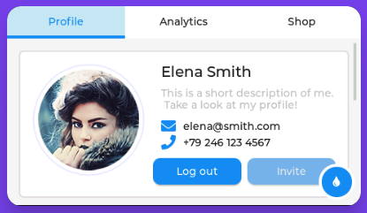
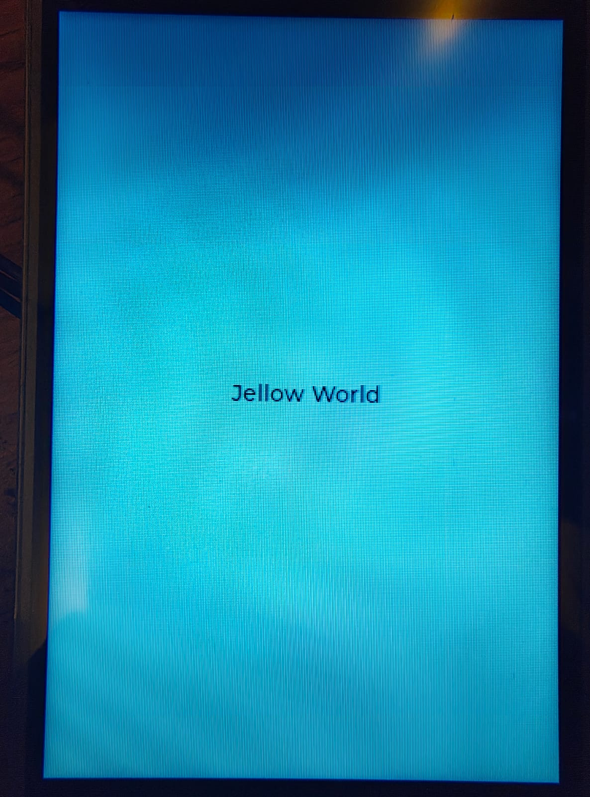

Con la pantalla de la Raspberry Pi ya configurada, en este tutorial podras compilar una demo de **[LVGL](https://lvgl.io/)** y después crearás una pantalla con un mensaje(Label) centrado en lenguaje C. Este tutorial continúa el [tutorial de configuración de la pantalla SPI XPT2046](/meta/02-rpi-xpt2046/). LVGL es una biblioteca de interfaces gráficas: ofrece objetos como etiquetas y botones.

Usaremos **fbdev**, la interfaz de framebuffer de Linux. El framebuffer es un dispositivo a través del cual un programa puede escribir una imagen sin ejecutar un gestor de ventanas. Esto permite probar una interfaz directamente en una pantalla pequeña. 

## 1. Preparar la Raspberry Pi

Usaremos la Raspberry Pi 4 con Parrot OS y la pantalla táctil SPI de 3,5 pulgadas del tutorial anterior, ya conectada y configurada.

Si todavía no has preparado la pantalla, sigue el [tutorial de pantalla SPI XPT2046](/meta/02-rpi-xpt2046/), que explica la conexión al GPIO, la configuración de SPI y del controlador y las comprobaciones de hardware. Para este tutorial basta con tener una pantalla funcional.

Comprueba los dispositivos de imagen desde una terminal de la Raspberry Pi:

```bash
ls -l /dev/fb*
```

Cada `/dev/fbN` representa un framebuffer. Debe existir al menos uno asociado a la pantalla; si hay varios, `/dev/fb0` no necesariamente corresponde a la pantalla pequeña. Consulta sus nombres y resoluciones con:

```bash
for fb in /sys/class/graphics/fb*; do
  printf '%s: ' "$fb"
  cat "$fb/name" "$fb/virtual_size"
done
```

El bucle lee la información publicada por el kernel sin cambiarla. Identifica el número de la pantalla y úsalo en los comandos siguientes: los ejemplos suponen `/dev/fb0`. La resolución y el nombre ayudan a distinguirla, aunque el nombre puede variar según el controlador. Si no aparece ningún framebuffer para la pantalla, revisa el overlay y su conexión antes de continuar.

## 2. Herramientas necesarias y descarga de LVGL

Antes de instalar paquetes, comprueba qué herramientas ya existen en la Raspberry Pi:

```bash
git --version
gcc --version
g++ --version
make --version
cmake --version
python3 --version
```

Estos comandos solo muestran las versiones. Si todos responden, continúa con la descarga sin instalar paquetes. Cada herramienta cumple una función:

| Herramienta | Función en el tutorial | Paquete habitual en Debian |
| --- | --- | --- |
| Git | Descarga el port y su submódulo de LVGL. | `git` |
| GCC y G++ | Compilan el código C y C++ de LVGL y el programa propio. | `build-essential` |
| Make | Ejecuta las reglas de compilación generadas por CMake y las del ejemplo propio. | `build-essential` |
| CMake | Lee la configuración y genera las reglas para compilar la biblioteca y la demo. | `cmake` |
| Python 3 | Ejecuta las herramientas que procesan la configuración de LVGL. | `python3` |

Estos son los paquetes básicos de esta configuración, además de las herramientas y bibliotecas habituales del sistema. 

Si falta alguna de estas herramienta en tu sistema puedes instalarlo de esta forma, si falta CMake:

```bash
apt-get install cmake
```

Descarga el port de LVGL oficial de Linux en tu directorio personal o en algun directorio que tengas especialmente para el codigo:

```bash
cd ~
git clone --recurse-submodules https://github.com/lvgl/lv_port_linux.git
cd lv_port_linux
```

`--recurse-submodules` descarga LVGL junto con el port. Si la descarga se interrumpe, completa los submódulos con `git submodule update --init --recursive` desde la carpeta del port. 

El port actual incluye Kconfiglib y puede usar el preprocesador de GCC para preparar la configuración. Con las herramientas anteriores disponibles, no es necesario crear un entorno virtual ni instalar paquetes adicionales de Python para comenzar.

## 3. Compilar y ejecutar la demostración

El port utiliza **Kconfig**, un sistema para elegir qué funciones y controladores se incorporan a la compilación. El archivo `.config`, situado en la raíz del port, guarda esas opciones. CMake lo lee al configurar LVGL y genera los valores que usarán la biblioteca y la demo. Si no existe, el port utiliza otra configuración predeterminada, que puede seleccionar un controlador distinto para la pantalla.

En `~/lv_port_linux`, crea o edita el archivo:

```bash
nano .config
```

Si ya existe, conserva tus otras opciones y ajusta las siguientes sin duplicarlas. Para una configuración nueva, escribe:

```text
CONFIG_LV_USE_LINUX_FBDEV=y
# CONFIG_LV_USE_LINUX_DRM is not set
CONFIG_LV_LINUX_FBDEV_RENDER_MODE_DIRECT=y
CONFIG_LV_LINUX_FBDEV_DOUBLE_BUFFER=y
CONFIG_LV_LINUX_FBDEV_MMAP=y
CONFIG_LV_USE_CLIB_MALLOC=y
CONFIG_LV_COLOR_DEPTH_16=y
CONFIG_LV_BUILD_DEMOS=y
CONFIG_LV_USE_DEMO_WIDGETS=y
# CONFIG_LV_BUILD_EXAMPLES is not set
```

Guarda con Ctrl+O, Enter y Ctrl+X. En Kconfig, `y` significa que una opción está habilitada; la línea con `# ... is not set` indica explícitamente que está deshabilitada. Las demás opciones toman sus valores predeterminados.

| Opción | Para qué sirve y por qué se utiliza |
| --- | --- |
| `LV_USE_LINUX_FBDEV` | Habilita el controlador que abre `/dev/fb0` y envía allí los píxeles de LVGL. |
| `LV_USE_LINUX_DRM` desactivada | Evita seleccionar el controlador DRM de LVGL para esta prueba. El controlador de Linux puede seguir usando DRM internamente. |
| `LV_LINUX_FBDEV_RENDER_MODE_DIRECT` | Usa un búfer del tamaño de la pantalla y dibuja las zonas modificadas en su posición. |
| `LV_LINUX_FBDEV_DOUBLE_BUFFER` | Reserva dos búferes de imagen. LVGL los mantiene sincronizados al renderizar en modo directo; esto requiere más memoria que usar uno solo. |
| `LV_LINUX_FBDEV_MMAP` | Permite acceder al framebuffer mediante memoria mapeada: Linux hace que una región de memoria represente el dispositivo. Es la opción usada en la configuración de referencia. |
| `LV_USE_CLIB_MALLOC` | Usa `malloc` y las funciones de memoria de C, en lugar del bloque fijo interno de LVGL. |
| `LV_COLOR_DEPTH_16` | Selecciona una profundidad de color predeterminada de 16 bits para LVGL. El formato que informa el framebuffer puede ser distinto: en la prueba informó 32 bits por píxel. |
| `LV_BUILD_DEMOS` | Incluye el código de las demostraciones en la compilación. |
| `LV_USE_DEMO_WIDGETS` | Activa la demostración concreta de widgets que ejecuta el port. Sin esta opción, compilar las demos no selecciona automáticamente esta interfaz. |
| `LV_BUILD_EXAMPLES` desactivada | Omite la compilación de los ejemplos adicionales de LVGL, que no son necesarios para ejecutar esta demo. |


Desde la raíz del port, configura y compila:

```bash
cmake -S . -B build
cmake --build build -j "$(nproc)"
```

`-S .` indica el directorio fuente y `-B build` guarda los archivos generados en `build`. CMake lee `.config` y genera la configuración necesaria para LVGL. El segundo comando compila, utilizando los procesadores disponibles. Cuando modifiques `.config`, vuelve a ejecutar ambos comandos para aplicar los cambios. La demo se genera en `build/bin/lvglsim` y la biblioteca en `build/lvgl/liblvgl.a`; el archivo `build/lvgl/autoconf.h` contiene la configuración generada que utilizará también la aplicación propia.

Comprueba el acceso al dispositivo con `ls -l /dev/fb0`. Si el grupo propietario es `video` y tu usuario todavía no pertenece a él, ejecuta `sudo adduser "$USER" video`, cierra sesión y vuelve a entrar. Esto modifica los grupos del usuario; la pertenencia se comprueba con `groups`. Si el dispositivo tiene otro grupo, usa el grupo que muestre `ls -l` y cuyas políticas permitan ese acceso.

De vuelta en `~/lv_port_linux`, ejecuta la demo:

```bash
./build/bin/lvglsim
```

Deberías ver la demo de los widgets en la pantalla. Termina con Ctrl+C en la terminal. Para otro framebuffer, antepone la variable de entorno: `LV_LINUX_FBDEV_DEVICE=/dev/fb1 ./build/bin/lvglsim`. Esta configuración no incluye evdev, de modo que la demo no responde al táctil.



## 4. Crear una interfaz propia

Crearemos la aplicación en un directorio independiente. Utilizará la biblioteca que ya compilamos, sin modificar la demostración ni volver a compilar LVGL al cambiar el programa. Desde cualquier directorio de la Raspberry Pi, crea la carpeta y el archivo:

```bash
mkdir -p ~/hola-lvgl
cd ~/hola-lvgl
nano main.c
```

`mkdir -p` crea el directorio si aún no existe; `cd` entra en él y `nano` abre el editor. Copia el ejemplo completo del [repositorio de referencia](https://github.com/zero-volts/zerovolts-ui/blob/main/examples/main_hello_world.c) en `main.c` y guarda con Ctrl+O, Enter y Ctrl+X:

```c
#include "lvgl.h"
#include "lv_linux_fbdev.h"
#include <unistd.h>
#include <stdio.h>

int main(void)
{ 
    lv_init();

    lv_display_t *display = lv_linux_fbdev_create();
    if (!display) {
        printf("No puedo crear el display!\n");
        return -1;
    } 

    lv_linux_fbdev_set_file(display, "/dev/fb0");
        
    lv_obj_t *active_screen = lv_screen_active();

    lv_obj_t *label = lv_label_create(active_screen);
    lv_label_set_text(label, "Jellow World");
    lv_obj_align(label, LV_ALIGN_CENTER, 0, 0);
    
     while(1) {
         lv_timer_handler();
         usleep(5000);
    }

    return 0;
}
```

Las cabeceras `lvgl.h` y `lv_linux_fbdev.h` declaran las funciones y tipos de LVGL y su controlador de framebuffer; `unistd.h` declara `usleep()`.

`lv_linux_fbdev_create()` crea un objeto de pantalla de tipo `lv_display_t`; `lv_linux_fbdev_set_file()` conecta ese objeto con `/dev/fb0`, el archivo que representa el framebuffer. Si identificaste otro framebuffer, cambia esa ruta. La creación del objeto y la apertura del archivo son pasos distintos: el control de `display` comprueba el primero. Puedes ver más detalles en la [documentación del controlador fbdev](https://docs.lvgl.io/9.2/integration/driver/display/fbdev.html).

`lv_screen_active()` devuelve la pantalla activa, que se usa como **padre** del label. Esto coloca el label dentro de esa pantalla. `lv_label_create()` crea el objeto, `lv_label_set_text()` le asigna el texto y `lv_obj_align()` lo centra; los dos ceros son desplazamientos horizontal y vertical. La [documentación del label](https://docs.lvgl.io/9.2/widgets/label.html) explica otras formas de mostrar y ajustar texto.

El bucle `while(1)` mantiene el programa en ejecución. En cada vuelta, `lv_timer_handler()` procesa las tareas pendientes de LVGL, como el refresco de la interfaz, y `usleep(5000)` cede el procesador aproximadamente cinco milisegundos. En esta versión, al crear el controlador fbdev también se configura una fuente de tiempo para LVGL. Puedes revisar cómo funcionan los [timers de LVGL](https://docs.lvgl.io/9.2/overview/timer.html).

## 5. Compilar y enlazar desde la terminal

Comprueba primero que existe la biblioteca compilada en el paso 3:

```bash
ls -l ~/lv_port_linux/build/lvgl/liblvgl.a
```

Si no aparece, vuelve a `~/lv_port_linux` y ejecuta `cmake --build build -j "$(nproc)"`. La ruta indicada corresponde a la rama y configuración empleadas en este tutorial.

Desde `~/hola-lvgl`, compila la aplicación y enlázala con esa liberia:

```bash
LVPORT="$HOME/lv_port_linux"
gcc -Wall -DLV_CONF_SKIP \
  -DLV_CONF_KCONFIG_EXTERNAL_INCLUDE="\"$LVPORT/build/lvgl/autoconf.h\"" \
  -I"$LVPORT/lvgl" -I"$LVPORT/lvgl/include" \
  -I"$LVPORT/lvgl/include/lvgl/drivers/display" \
  main.c "$LVPORT/build/lvgl/liblvgl.a" \
  -lm -lpthread -ldl -o hola-lvgl
```

`LVPORT` guarda la ruta del port para esta terminal. `gcc` compila el archivo y enlaza la biblioteca estática ya creada. Los argumentos `-I` indican dónde buscar las cabeceras; las opciones `-DLV_CONF_SKIP` y `-DLV_CONF_KCONFIG_EXTERNAL_INCLUDE` hacen que la aplicación use el mismo archivo `autoconf.h` generado al compilar LVGL. Las comillas incluidas en la definición permiten que el preprocesador trate esa ruta como un nombre de archivo. Las opciones `-lm`, `-lpthread` y `-ldl` enlazan las bibliotecas del sistema; `-o` indica el nombre del ejecutable. La biblioteca aparece después de `main.c` para que el enlazador resuelva sus referencias.

Si el comando termina sin errores, ejecútalo desde la misma carpeta:

```bash
./hola-lvgl
```

Debería aparecer **Jellow World** en el centro de la pantalla. Ctrl+C detiene el programa. Para experimentar, cambia el texto en `main.c`, guarda y repite el comando `gcc`: solo se recompila y enlaza tu aplicación. La biblioteca se recompila si cambias la configuración de LVGL o su código; en ese caso, vuelve a ejecutar la compilación de CMake del paso 3 antes de enlazar la aplicación.



## 6. Automatizar la compilación con Make

Un **Makefile** guarda las reglas para construir un programa y sus dependencias. Así no necesitas escribir nuevamente todas las opciones de `gcc`. En `~/hola-lvgl`, crea el archivo con `nano Makefile` y copia lo siguiente. Las dos líneas de comando que comienzan con `$(CC)` y `rm` deben empezar con un **tabulador**, no con espacios:

```makefile
CC = gcc
LVPORT = $(HOME)/lv_port_linux
CPPFLAGS = -DLV_CONF_SKIP -DLV_CONF_KCONFIG_EXTERNAL_INCLUDE='"$(LVPORT)/build/lvgl/autoconf.h"' -I$(LVPORT)/lvgl -I$(LVPORT)/lvgl/include -I$(LVPORT)/lvgl/include/lvgl/drivers/display
CFLAGS = -Wall
LDLIBS = -lm -lpthread -ldl

.PHONY: all clean
all: hola-lvgl

hola-lvgl: main.c $(LVPORT)/build/lvgl/liblvgl.a $(LVPORT)/build/lvgl/autoconf.h
	$(CC) $(CPPFLAGS) $(CFLAGS) main.c $(LVPORT)/build/lvgl/liblvgl.a $(LDLIBS) -o $@

clean:
	rm -f hola-lvgl
```

`LVPORT` señala dónde está el port; cambia esa ruta si lo descargaste en otro lugar. `CPPFLAGS`, `CFLAGS` y `LDLIBS` agrupan las opciones del preprocesador, del compilador y las bibliotecas. La regla `hola-lvgl` depende del archivo fuente y de la biblioteca: `make` vuelve a enlazar si cualquiera de ellos cambia, y `$@` representa el nombre del ejecutable. La regla no reconstruye LVGL; si falta la biblioteca, compílala primero con CMake como se indicó arriba.

Desde `~/hola-lvgl`, ejecuta:

```bash
make
./hola-lvgl
```

La primera orden crea o actualiza el ejecutable; la segunda lo inicia. Tras editar `main.c`, basta con ejecutar `make` otra vez. Si no hay cambios, Make informa que no hay trabajo pendiente. `make clean` elimina únicamente el ejecutable local `hola-lvgl`; no borra el código ni la biblioteca.

## 7. Si algo no funciona

- **No aparece `/dev/fb0` o la imagen sale en otra pantalla:** revisa los dispositivos y sus nombres en `/sys/class/graphics`, la configuración de arranque y el número usado en el programa.
- **Permiso denegado:** comprueba propietario y grupo con `ls -l /dev/fb0`, tu pertenencia con `groups` y vuelve a iniciar sesión después de cambiarla.
- **La pantalla está negra o la imagen aparece parcialmente:** verifica que ningún otro programa esté dibujando simultáneamente sobre el framebuffer y consulta la configuración de formato y modo de renderizado del [controlador fbdev](https://docs.lvgl.io/9.2/integration/driver/display/fbdev.html).
- **El táctil no responde:** la demo y la aplicación propia no configuran entrada en este tutorial. Para usar el táctil es necesario habilitar evdev y configurarlo.
- **CMake pide DRM o SDL:** comprueba que tu `.config` activa framebuffer y no activa SDL o DRM; la configuración inicial del port utiliza SDL si no se crea `.config`.
- **Error de cabeceras o símbolos:** confirma que descargaste los submódulos, compilaste LVGL con la configuración de `.config` y que las rutas `-I` y la biblioteca coinciden con tu instalación. Si Make indica `missing separator`, comprueba que las recetas comiencen con un tabulador.

Con esto ya tienes una base para crear otros objetos LVGL y entender la separación entre dibujo, pantalla y entrada. Para interacción con el touch tendrás que identificar y configurar el dispositivo de entrada correspondiente (que lo veremos en un próximo tutorial).

## Referencias

- [Port oficial de LVGL para Linux](https://github.com/lvgl/lv_port_linux).
- [Controlador Linux framebuffer de LVGL](https://docs.lvgl.io/master/details/integration/embedded_linux/drivers/fbdev.html).
- [Ejemplo de referencia `main_hello_world.c`](https://github.com/zero-volts/zerovolts-ui/blob/main/examples/main_hello_world.c), del repositorio Zero-Volts, distribuido bajo [GPL-3.0](https://github.com/zero-volts/zerovolts-ui/blob/main/LICENSE). El código de este artículo reproduce ese ejemplo.
