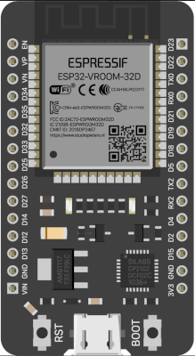
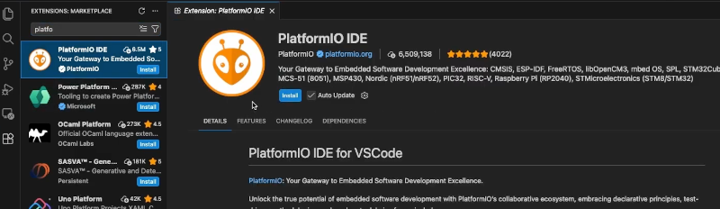
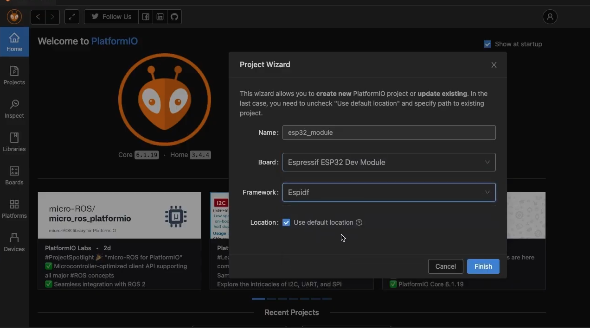
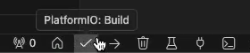
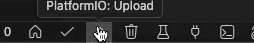
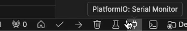

En este tutorial programarás un ESP32 DevKit con C y ESP-IDF. Primero enviarás un saludo al monitor serie; después harás parpadear un LED. Así comprobarás tanto la carga del programa como el control de una salida física.


<iframe
    width="600" height="338" style="width: 100%; max-width: 600px; aspect-ratio: 16 / 9; height: auto;"
    src="https://www.youtube.com/embed/gRvERgO8wck"
    title="Configuración de botones y calibración táctil con LVGL" loading="lazy"
    allow="accelerometer; autoplay; clipboard-write; encrypted-media; gyroscope; picture-in-picture"
    allowfullscreen>
</iframe>

## Materiales

- Una placa de desarrollo con **ESP32**, como ESP32 DevKit o ESP32 Dev Module, y un cable USB que transmita datos.
- Visual Studio Code, conexión a Internet y la extensión **PlatformIO IDE**.



## 1. Crear el proyecto

1. Instala [Visual Studio Code](https://code.visualstudio.com/) y, en Extensions, busca e instala **PlatformIO IDE**. 



Reinicia el editor si se solicita y espera a que termine la instalación inicial.

2. Abre PlatformIO Home y selecciona **New Project**. Elige un nombre, la placa **Espressif ESP32 Dev Module** (`esp32dev`) y el framework **ESP-IDF**. Finaliza la creación y abre el proyecto.



3. Comprueba que `platformio.ini`, en la raíz del proyecto, contenga esta configuración:

```ini
[env:esp32dev]
platform = espressif32
board = esp32dev
framework = espidf
monitor_speed = 115200
```

`platform` selecciona las herramientas para la familia Espressif;

`board` define la placa objetivo 

`framework` selecciona ESP-IDF.

`monitor_speed` establece el monitor serie en 115200 baudios, la velocidad habitual de la consola del ESP32. 

La primera compilación descarga dependencias y puede tardar varios minutos.

El directorio `src` contiene el código de la aplicación. El proyecto ESP-IDF también utiliza archivos `CMakeLists.txt`: CMake organiza la compilación y PlatformIO los genera cuando son necesarios. No hace falta modificar el firmware de ningún otro proyecto.

## 2. Hola Mundo!

Crea o reemplaza `src/main.c` con este programa completo:

```c
#include <stdio.h>

void app_main(void)
{
    printf("Hola mundo desde ESP32!\n");
}
```

Conecta la placa por USB. En la barra de PlatformIO de VS Code (barra inferior) podras ver 3 opciones que se ocupan para poder cargar y hacer pruebas de nuesto codigo, son las siguientes:

- **Build**
 
- **Upload**
 
- **Serial monitor**
 

Selecciona **Build** y espera el resultado `SUCCESS`. Después selecciona **Upload**: PlatformIO compila si es necesario y graba el firmware en la memoria flash del ESP32. La primera carga puede tardar más porque también se preparan las herramientas y el framework.

Abre **Serial Monitor** desde PlatformIO. Si solo aparecen mensajes de arranque o no ves el saludo, pulsa el botón **EN** o **RESET** de la placa con el monitor abierto. Deberías ver `Hola mundo desde ESP32!` entre los mensajes de arranque. Si el texto es ilegible, comprueba que el monitor esté a 115200 baudios. Cierra el monitor antes de una nueva carga si mantiene ocupado el puerto.

## 3. Identificar el LED integrado

Un **GPIO** es un pin de entrada o salida de propósito general. Como salida, puede establecerse en nivel alto o bajo para controlar un circuito. En este ejercicio utilizaremos el LED integrado en la placa, como en el video, por lo que no necesitas conectar un LED externo.

Muchas placas ESP32 DevKit conectan ese LED a **GPIO 2**; el ejemplo usa ese pin. El GPIO y la polaridad dependen del modelo. No lo confundas con el LED de alimentación, que normalmente permanece encendido(rojo) mientras la placa recibe energía.

## 4. Hacer parpadear el LED

Reemplaza todo `src/main.c` por el siguiente programa y guarda el archivo:

```c
#include <stdio.h>
#include "driver/gpio.h"
#include "esp_err.h"
#include "freertos/FreeRTOS.h"
#include "freertos/task.h"

#define LED_GPIO GPIO_NUM_2

void app_main(void)
{
    gpio_reset_pin(LED_GPIO);
    gpio_set_direction(LED_GPIO, GPIO_MODE_OUTPUT)
    
    printf("El LED comenzara a parpadear.\n");

    while (1)
    {
        gpio_set_level(LED_GPIO, 1)
        vTaskDelay(pdMS_TO_TICKS(1000));

        gpio_set_level(LED_GPIO, 0);
        vTaskDelay(pdMS_TO_TICKS(1000));
    }
}
```

`gpio_reset_pin` restablece la configuración del pin y `gpio_set_direction` lo prepara como salida.

En el bucle, `gpio_set_level` selecciona 1 para nivel alto y 0 para nivel bajo. ESP-IDF ejecuta la aplicación sobre FreeRTOS, un sistema que administra tareas; `vTaskDelay` suspende la tarea y permite ejecutar otras mientras espera. `pdMS_TO_TICKS(1000)` convierte 1000 milisegundos a la unidad de tiempo de FreeRTOS. Con un LED activo en nivel alto, este permanece aproximadamente un segundo encendido y otro apagado, y el ciclo se repite. 

Selecciona **Upload** nuevamente. Al terminar, el LED debe parpadear y el monitor serie mostrará el mensaje de inicio tras un reinicio. Prueba cambiar ambos valores de `1000` a `500`, guardar y cargar de nuevo: cada estado durará aproximadamente medio segundo.

## Si algo no funciona

- **No aparece el puerto o falla la carga:** comprueba que el cable transmita datos, que la placa esté alimentada y que ningún otro programa use el puerto. Algunas placas necesitan mantener pulsado **BOOT** cuando comienza la conexión de carga y soltarlo cuando esta empieza. En Linux puede ser necesario dar al usuario permiso para el dispositivo serie y volver a iniciar sesión.
- **No aparece el saludo:** abre el monitor a 115200 baudios y pulsa **EN/RESET**; el primer programa escribe una sola vez al arrancar.
- **El LED no parpadea:** asegúrate de haber cargado el segundo programa y comprueba en el esquema de tu placa que el LED controlable esté conectado a GPIO 2. Si usa otro GPIO, cambia `LED_GPIO` por el valor correspondiente. El LED de alimentación no sirve para esta prueba.
- **La compilación falla:** confirma que el proyecto usa `framework = espidf`, que el archivo se llama `src/main.c` y que la instalación inicial de PlatformIO terminó.

Has utilizado el puerto serie para observar el programa y un GPIO para controlar una salida, con retardos que dejan tiempo al resto de tareas del sistema.

## Referencias

- [ESP32 Dev Module en PlatformIO](https://docs.platformio.org/en/latest/boards/espressif32/esp32dev.html) y [ESP-IDF en PlatformIO](https://docs.platformio.org/en/latest/frameworks/espidf.html).
- [Controlador GPIO de ESP-IDF](https://docs.espressif.com/projects/esp-idf/en/stable/esp32/api-reference/peripherals/gpio.html).
- [Video: ESP32 desde cero, primer Hola Mundo y encendiendo el LED](https://www.youtube.com/watch?v=gRvERgO8wck).
- [Firmware Zero-Volts](https://github.com/zero-volts/zerovolts_firmware).
